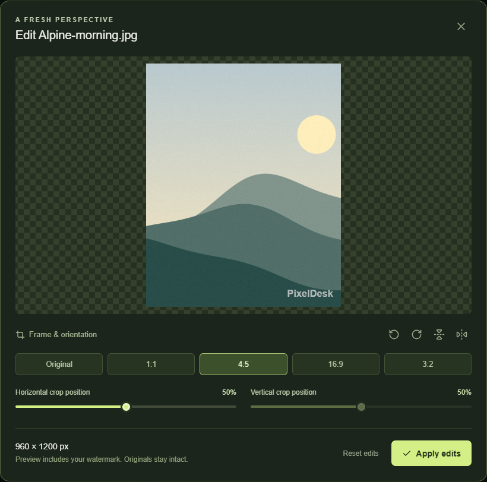

<div align="center">

# PixelDesk

### Your images. A little lighter.

A private-by-design image studio for cropping, resizing, watermarking, and optimizing images directly in your browser.

[**Launch the live demo**](https://pixeldesk-beige.vercel.app) · [Features](#features) · [Getting started](#getting-started) · [Deployment](#deployment)


**No account required · No image uploads · No API keys**

</div>


## Overview

PixelDesk helps creators, developers, and shop owners prepare images for websites, social posts, and product listings. Add a batch, edit individual images, choose export settings, and download the results together.

Image processing happens on your device using the browser's Canvas API. Original files remain available for reversible edits during the session, and only processing preferences are saved between visits.

## Features

| Capability                  | What you can do                                                                                                        |
| --------------------------- | ---------------------------------------------------------------------------------------------------------------------- |
| **Batch processing**        | Drag and drop up to 20 JPG, PNG, or WebP images and process them sequentially.                                         |
| **Crop and orientation**    | Rotate, flip, and crop each image to square, 4:5, 16:9, or 3:2 framing, with controls for crop position.               |
| **Resize**                  | Use width presets or a custom maximum width up to 8192 px. Aspect ratios stay intact, and images are never enlarged.   |
| **Format conversion**       | Export WebP, JPG, or PNG. Adjust quality for lossy formats.                                                            |
| **Size targeting**          | Set a target file size for JPG or WebP. PixelDesk adjusts quality and warns when the target cannot be reached.         |
| **Watermarks**              | Add text with configurable color, position, opacity, and size; preview it in the editor before exporting.              |
| **Before/after comparison** | Inspect the original and processed image with a comparison slider and real file-size measurements.                     |
| **Batch controls**          | Search and sort files, stop after the current image, and resume unfinished work without reprocessing completed images. |
| **Downloads**               | Download individual images or a ZIP archive, with optional custom names and stable sequence numbers.                   |
| **Accessible interface**    | Responsive layouts, keyboard controls, native dialogs, and reduced-motion support.                                     |

Built-in sample landscapes let you try the workflow without choosing personal files. The samples are generated locally in the browser.

## Editor preview

The editor shares its rendering pipeline with the export process, so framing and watermark controls use the same drawing logic.

<div align="center">



</div>

## How to use

1. **Add images.** Drag files into the workspace, choose them from your device, or try the samples.
2. **Choose export settings.** Select a preset or customize the format, quality, and maximum width.
3. **Edit individual images.** Open the crop icon beside an image to adjust its framing and orientation. Add a batch watermark or export name if needed.
4. **Optimize and inspect.** Process the batch, review size changes, and compare individual results.
5. **Download.** Save one image or download all completed images as a ZIP archive.

## Tech stack

| Layer                 | Technology                                               |
| --------------------- | -------------------------------------------------------- |
| Interface             | React, TypeScript, CSS                                   |
| Development and build | Vite                                                     |
| Image processing      | Canvas 2D, browser image decoding, `toBlob`, object URLs |
| ZIP generation        | JSZip                                                    |
| Icons                 | Lucide React                                             |
| Browser testing       | Playwright                                               |
| Code formatting       | Prettier                                                 |
| Hosting               | Vercel                                                   |

## Getting started

### Prerequisites

- Node.js **22.12 or newer**; Node.js 24 is suitable.
- npm, included with Node.js.

### Run locally

```sh
git clone https://github.com/CodeWithRahoul/pixeldesk.git
cd pixeldesk
npm ci
npm run dev
```

Open the local URL printed by Vite. No environment variables, database, or API credentials are needed to run the application.

### Available commands

| Command           | Purpose                                                           |
| ----------------- | ----------------------------------------------------------------- |
| `npm run dev`     | Start the development server.                                     |
| `npm run build`   | Run TypeScript checks and create the production build in `dist/`. |
| `npm run preview` | Preview the production build locally.                             |
| `npm test`        | Run the browser test suite.                                       |
| `npm run format`  | Format the project with Prettier.                                 |

## Testing

Install the browser used by Playwright, then run the suite:

```sh
npx playwright install chromium
npm test
```

The **11 browser tests** cover actual image processing and user workflows, including:

- Output dimensions, image signatures, and ZIP contents.
- Exact pixel positions after rotation, flipping, and positioned crops.
- Watermark pixels in both previews and exported images.
- Transparent-to-JPG compositing and prevention of upscaling.
- Target file sizes and warnings for unattainable targets.
- Stable filenames when identically named files are removed and added.
- Batch stop/resume behavior, search, sorting, and saved preferences.
- Invalid inputs, legacy settings, dialogs, and mobile layouts.

To use an existing Chrome installation instead, set `PLAYWRIGHT_CHANNEL=chrome` in your environment before running `npm test`.

## Deployment

**Production:** [pixeldesk-beige.vercel.app](https://pixeldesk-beige.vercel.app)

The repository includes a `vercel.json` configuration:

| Setting                           | Value           |
| --------------------------------- | --------------- |
| Framework                         | Vite            |
| Build command                     | `npm run build` |
| Output directory                  | `dist`          |
| Application environment variables | None required   |

### Deploy your own copy

1. Fork this repository or push a copy to your GitHub account.
2. In Vercel, import the repository as a new project.
3. Use the repository root as the Root Directory and keep the settings above.
4. Deploy the project.

You can also run `npx vercel` from the project directory and follow the prompts. See the [official Vercel guide for Vite](https://vercel.com/docs/frameworks/frontend/vite).

Automatic deployments require connecting the repository in the Vercel project's Git settings and granting the Vercel GitHub App access. A repository being public does not itself establish this connection. See [Vercel's GitHub integration documentation](https://vercel.com/docs/git/vercel-for-github).

## Architecture

```text
Source files
    |
    v
Validate and decode
    |
    v
Per-image crop, rotation, and flip settings
    |
    v
Canvas rendering + optional text watermark
    |
    v
Format encoding + optional size-target search
    |
    v
Local previews and individual / ZIP downloads
```

Processing runs sequentially to limit simultaneous canvas allocations. Crop coordinates are defined after rotation and flipping; a single Canvas transformation combines these operations without allocating a second full-size intermediate image.

For size targets, the processor first encodes at the selected quality ceiling. If necessary, it tests a 10% minimum quality and performs up to seven binary-search steps to find a fitting quality. It preserves a downloadable result and displays a warning when the target cannot be met.

Preview URLs are released when files are removed, outputs are replaced, or the app unmounts. Export sequence numbers stay stable when a batch is resumed or files are removed.

### Project structure

```text
pixeldesk/
├── public/                  # Favicon and public assets
├── src/
│   ├── App.tsx              # Workspace and batch workflow
│   ├── AdvancedSettings.tsx # Watermark and export controls
│   ├── EditorDialog.tsx     # Per-image editing and live preview
│   ├── image.ts             # Validation, rendering, encoding, downloads
│   ├── settings.ts          # Defaults and saved-settings normalization
│   ├── styles.css           # Main interface styles
│   ├── enhancements.css     # Editing and advanced-control styles
│   └── main.tsx             # Application entry point
├── tests/                   # Playwright browser tests
├── artifacts/               # Screenshots and project previews
└── vercel.json              # Deployment configuration and headers
```

## Privacy and limitations

Images are processed locally and are not uploaded by the application. Source images and edits are not persisted after a reload; only export preferences are stored in local storage. The interface loads fonts from Google Fonts, which receives standard font requests but no image data.

| Limit or behavior  | Details                                                                                                                                            |
| ------------------ | -------------------------------------------------------------------------------------------------------------------------------------------------- |
| Batch limit        | 20 images; up to 25 MB and 40 megapixels per source image.                                                                                         |
| Input formats      | JPG, PNG, and WebP. GIF, SVG, HEIC, and AVIF are not supported.                                                                                    |
| Animation          | Animated WebP exports as a still image.                                                                                                            |
| PNG output         | Lossless; quality adjustment and size targeting do not apply.                                                                                      |
| JPG output         | Transparent areas are filled with white.                                                                                                           |
| Metadata and color | Canvas export removes embedded metadata and may change the appearance of specially profiled or wide-gamut images.                                  |
| Compression        | Savings depend on the source and settings. Some outputs may be larger than the original.                                                           |
| Performance        | Processing uses the main browser thread. Very large images may briefly affect responsiveness, and large batches depend on available device memory. |

## Roadmap

Potential next steps include off-main-thread rendering with OffscreenCanvas, image-based watermarks, locally hosted fonts, and more export presets. These are planned ideas, not existing features.

## Contributing

Issues and focused pull requests are welcome. Describe the problem or proposed improvement, keep changes scoped, and include relevant validation. For processing changes, add a browser test that checks the exported result.

## Author

Built by [CodeWithRahoul](https://github.com/CodeWithRahoul).

If you find PixelDesk useful, consider starring the repository.
