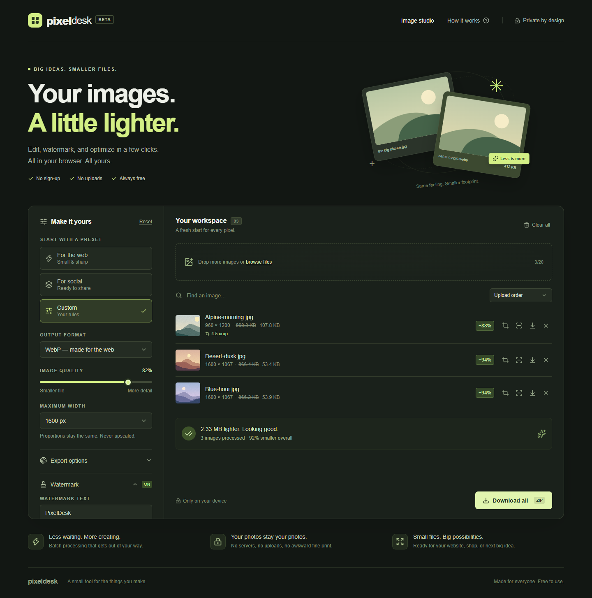

# PixelDesk

A free browser-based image studio. Resize, compress, convert, compare, and download batches of images without an account or uploading files to a server.



[See the crop and watermark editor](artifacts/studio-editor.png).

## Run locally

Requires Node.js 22.12 or newer.

```sh
npm ci
npm run dev
```

Open the local URL printed by Vite. To create a production build:

```sh
npm run build
npm run preview
```

## Deploy to Vercel

1. Push this `pixeldesk` directory to a GitHub repository.
2. In Vercel, choose **Add New → Project** and import the repository.
3. If the repository contains the parent directory, set **Root Directory** to `pixeldesk`. Otherwise leave it at the repository root.
4. Vercel reads `vercel.json`: framework **Vite**, build command `npm run build`, output directory `dist`.
5. Select **Deploy**. No API keys, database, or environment variables are required.

Alternatively, run `npx vercel` from this directory and follow the prompts. See [Vercel's Vite deployment documentation](https://vercel.com/docs/frameworks/frontend/vite).

## Features

- Drag and drop up to 20 JPG, PNG, or WebP images.
- Resize with preserved aspect ratios and no upscaling.
- Export WebP, JPG, and PNG with configurable quality for lossy formats.
- Web and social presets, plus custom settings saved locally.
- Before/after comparison with a slider and actual size savings.
- Individual downloads and a ZIP archive with collision-free filenames.
- Responsive layout, keyboard controls, native accessible dialogs, and reduced-motion support.
- Built-in sample landscapes generated locally; no sample image network requests.
- File validation, per-image errors, and explicit export failure handling.
- Per-image editing with live previews: rotate, flip, and crop to original, square, portrait 4:5, widescreen 16:9, or 3:2 framing. Crop position sliders let you choose which part to keep.
- Custom maximum widths from 1 to 8192 px, with no upscaling.
- Text watermarks with position, color, opacity, and size controls, previewed in the image editor.
- Target file sizes for JPG and WebP: automatically search for a quality level that fits, or report when the target cannot be reached.
- Custom batch filenames with stable sequence numbers, including when adding and removing files between processing runs.
- File search and sorting by name, size, or upload order.
- Stop processing after the current image finishes, download completed images, and resume pending files later.

## How it works

React and TypeScript handle the interface. The browser decodes each source image and draws it onto a Canvas at its target dimensions, then encodes a new file with `toBlob`. Processing runs sequentially to limit simultaneous canvas allocations. JSZip bundles the resulting images. Object URLs provide local previews and are released on removal, replacement, and unmount. There is no application backend.

Crop coordinates are defined after rotation and flipping. The renderer combines these operations into one Canvas transformation, avoiding a second full-size intermediate canvas. The editor uses the same renderer as the final export. Edits remain reversible because every render starts from the original file.

Target-size processing first encodes at the selected quality ceiling. When needed, it tests the minimum quality (10%) and performs up to seven binary-search steps to find a fitting quality. A result that cannot meet the target is still downloadable and shows a warning suggesting a smaller width. PNG exports do not use size targets. Export filenames remain stable when files are removed or a stopped batch is resumed.

Image limits are 25 MB per file and 40 megapixels per source. Original images are not persisted. Only processing preferences are saved in local storage. Google Fonts supplies the interface typefaces; no image data is sent there. Replace the CSS font import with locally hosted fonts for a fully self-contained deployment.

## Known behavior

- PNG is lossless; its quality slider is disabled.
- Transparent pixels become white when exporting JPG.
- Canvas export strips embedded metadata and does not preserve all source color profiles. Results can look different for wide-gamut or specially profiled inputs.
- Animated WebP is exported as a still image. GIF, SVG, HEIC, and AVIF input are not supported.
- A converted file can be larger than its source. Results show actual size changes.
- WebP export requires browser support. Unsupported exports produce an explicit error instead of silently downloading a mislabeled PNG.
- Large batches depend on available device memory. This version processes on the main browser thread; encoding is asynchronous, but decoding and drawing very large images may briefly affect responsiveness.

## Browser tests

```sh
npx playwright install chromium
npm test
```

Tests cover real image encoding and resizing, archive contents and file signatures, duplicate filenames, transparent JPG compositing, invalid files, persisted settings, comparison controls, and mobile layout.

The enhancement tests also verify exported pixel positions after rotation, flipping, and crop positioning; actual watermark pixels in previews and downloads; custom filenames; target sizes; custom width persistence; batch cancellation and resumption; search and sorting; and migration of legacy saved preferences.

To use an already installed Chrome browser instead of downloading Playwright Chromium, set the environment variable `PLAYWRIGHT_CHANNEL=chrome` before running tests. Format source with `npm run format`.

## Portfolio talking points

The project demonstrates a complete client-side file workflow, binary data handling, browser APIs, resource cleanup, responsive interface design, accessibility, automated browser testing, and static deployment. Describe the actual measured results and design decisions in your portfolio; the app intentionally avoids invented usage metrics.

Possible future work: off-main-thread processing with OffscreenCanvas, image watermarks, background removal, and locally hosted fonts.
